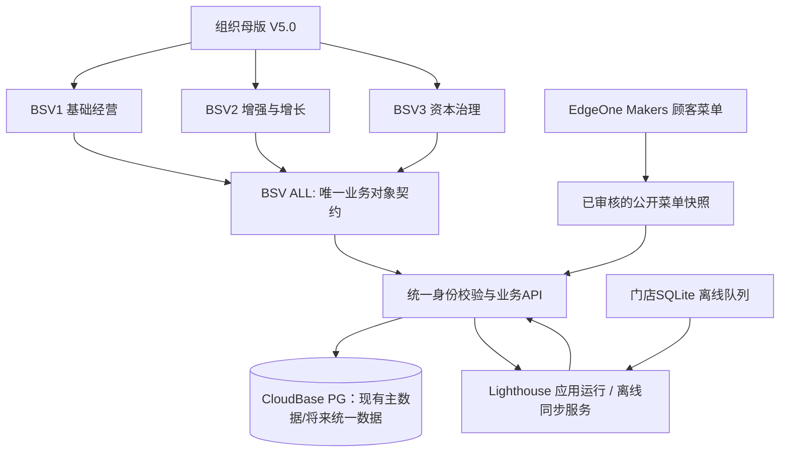

# 唯一系统关系图

## 三种不同划分维度，绝不可混同

- **经营归属** `capabilities/bsv1|bsv2|bsv3`：事情属于哪个经营圈层，责任与目的。
- **事实归属** `domains/*`：该实体的唯一 owner，使用 `config/data-ownership.json` 检查。
- **界面入口** `apps/*`：谁看到什么操作页面，不能创造同义业务事实。

备注：此图是目标逻辑关系；具体程序端点、网络拓扑和当前配置必须由真实资源盘点确认。

## 圈层分界案例

- 调酒产品配方与SKU：BSV1；总部用它策划营销：BSV2；`catalog.product_id` 唯一。
- 门店自制原料：BSV1；同配方中央制作配送：BSV2；共用 `production.batch_id`、`catalog.material_id`。
- 员工日常门店账号协作：BSV1；总部营销投放：BSV2；共同引用 `marketing` 域事件，但预算审批不同。
- 门店清洁和日常质检：BSV1；独立督查复验：BSV2；由 `quality` 域存证且审核者不等于执行者。
- 门店费用和薪资：BSV1；剩余可投资资本与股权：BSV3；`operating_finance` 与 `capital` 通过已核验财务报表交接。
