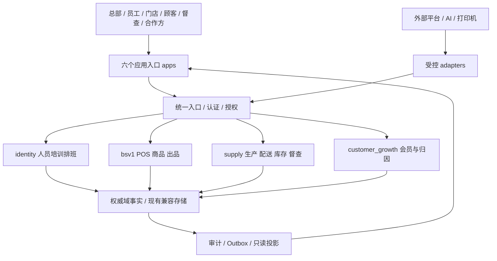
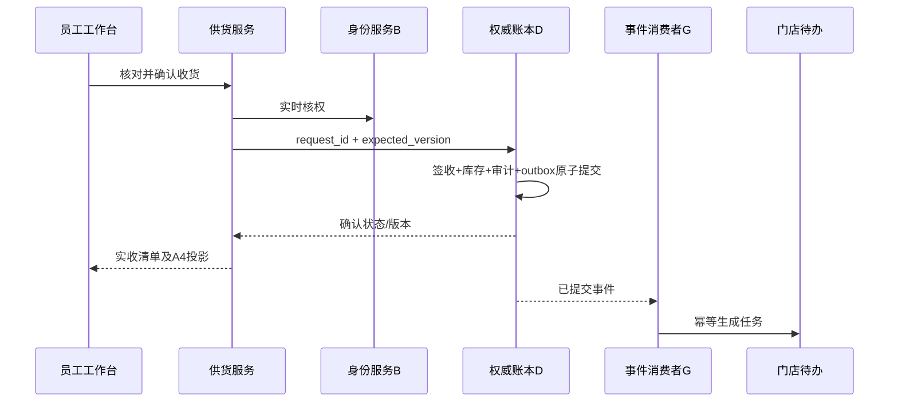

# BSV ALL 2026–2031｜五年企业软件底层架构总纲
Enterprise Architecture · System Map · Domain Ownership · Database · API · Events · Security · Deployment · AI Handoff
版本 FOUNDATION-1.0-RC1 | 2026-11-27 | PROPOSED_BASELINE / NOT_RUNTIME_CERTIFIED
**唯一日常研发入口 A（A+C-V1）**：本文件包含固定架构正文与第8节的活动变更标注。原注册表仍是唯一机器技术权威。[不可变架构原版SHA](https://github.com/Ethancao258/bsv-all-platform/blob/6c64056f2d96f545a346ad94c169d53e502b3f14/docs/architecture/five-year-foundation/BSV_ALL_2026_2031_ENTERPRISE_ARCHITECTURE_FOUNDATION.md) 永久保留，不包含后续动态状态。今后日常开发只修改本文件第8节的活动标注及对应唯一执行Issue C；不改架构原则、原有代码归属、数据库owner及其他固定正文。原独立B清单仅作历史档案，不再维护。#44/#58 发布门禁不变，#52/#59未获开工授权。

## 1. 一眼看懂：C4层级及业务边界
系统上下文：经营负责人/总部、门店员工、顾客、独立督查、合作方 -> BSV ALL；外部支付、市场平台、AI及设备 -> 受控适配器 -> BSV ALL。BSV1/2/3是企业业务责任圈层，不是软件版本、进程或数据库；现行中央供货注册在BSV2，门店基础库存属BSV1，不在本审计重分类。

容器级：参考集成分支存在四个业务后端目录；不等于四个实际独立进程。网关负责入口与路由；identity服务负责认证关联、人员、授权、学院和排班；bsv1负责订单/桌台、商品投影、出品及相关UI；supply负责供货业务入口及A–G适配；customer_growth负责顾客注册、同意与归因。具体进程、运行SHA、数据位置以受控主机证据为准，不公开真实端口/地址/私有日志。组件和代码级详见实现手册与机器索引。
### 层级约束
- L0 业务圈层 BSV1/2/3：仅经营归属。
- L1 入口：六个UI入口；不得绕过业务API访问数据库。
- L2 管理索引 M01–M25：供人/AI快速检索；不作为数据库主键或部署单元。
- L3 技术模块：config/change-routing.json的module_id；新增路由需注册，不把M号直接当module_id。
- L4 20个数据域：由config/domain-registry.json和data-ownership.json定义；多个域可在同一PG，一域可使用受控投影，事实只有一个权威写入者。
- L5 物理运行/存储：依据release manifest与实际schema；技术变化可通过兼容迁移完成。

## 2. 永久目录及责任
|根目录|唯一职责|
|---|---|
|.github|CI与审查自动化|
|apps|页面、展示、用户工作流|
|capabilities|业务圈层能力与用例|
|domains|业务语义、实体、约束|
|services|API、任务、同步等运行实现|
|integrations|外部平台/设备/AI适配器|
|cloudbase|历史官方迁移、审计及计划|
|contracts|稳定API、事件、数据、导入契约|
|platform|部署、环境、运行控制及隔离迁移|
|ingestion|导入、校验、隔离、映射|
|docs|治理、决策、架构、操作手册|
|config|注册表及非秘密逻辑配置|
|tests|自动化业务/契约/权限/回归验证|
|scripts|受控工程工具|
保留所有根目录，新增功能放在现有二三级目录；根目录或权威ID变更只允许ADR+兼容迁移。不能以五年架构为由重写现有应用或强制物理迁库。

## 3. 技术决策：冻结什么、允许什么
|决策|稳定约束|允许演进|
|---|---|---|
|F01 身份|永久自然人身份、经批准的员工派生码及别名；一人多门店授权|认证提供者、UI、权限细分|
|F02 主数据|商品/物料、门店、员工、客户各唯一owner，不能用名称/SKU作连接键|字段、分类、导入方式、物理库|
|F03 交易|订单、收款、支付机构确认、库存流水分别有权威事实|新支付渠道、新门店、POS界面|
|F04 依赖|跨域通过已批准API/事件或受控只读投影；跨域事务只能由已指定协调者完成|模块内部实现、可测试的提取|
|F05 历史|事件与历史快照不无痕覆盖；纠错追加；历史成本/价格/配方保持版本|新的报告算法及补偿规则|
|F06 租户|法人/门店范围由服务端授权；未来外部租户禁止共用无隔离主档|新增组织和租户、依法独立数据|
|F07 发布|一个已批准写入负责人、不可变发布SHA、版本证据、恢复路径|部署工具、主机、数据库版本|
|F08 演进|ADR只处理实质性架构改动；旧决策保留并标superseded；新功能先登记议案|日常兼容扩展无需总架构重审|
|F09 安全|凭证/真实经营数据不进公开Git；外部AI只通过授权接口，风险动作审批|新的供应商、设备、模型|
|F10 生存|核心营业不依赖可选AI/增长/通知；失效权限/未确认资金/不安全食品均fail closed|离线合法工作方式与受控同步|
任何不可逆变更或拆分需要回滚/前向修复计划，版本兼容和数据保全。冻结是规则不是停止改进。

## 4. 权威索引及查找入口
优先级：现行经批准治理/ADR及数据owner > 与该环境匹配的schema和API契约 > 已批准实际运行证据（说明实现现状而非授权） > 阅读索引 > 讨论。冲突登记并停止相关危险写入，不自动选任意版本。
- main 的 config/architecture-lock.json、app-registry.json、domain-registry.json、data-ownership.json、use-case-registry.json 是治理基线。
- 参考开发分支的 config/change-routing.json、data-contracts.json、contracts/database、contracts/supply、contracts/identity、contracts/menu 作为已有实现契约证据；main尚未包含前两文件，不能假定已合并。
- 实际主机与发布证据由 docs/ops/CURRENT_STATE.md 及受控证据清单维护；公开Git只放无敏感内容的哈希及状态。
- 本文件第8节（25模块及活动议案）；[机器索引](ARCHITECTURE_REFERENCE_INDEX.json)包含6入口、20域、65键及12路由引用。索引是固定SHA的审计快照，不是新权威注册表。
- PR #57 后续任务路线；#44/#58 当前发布门禁；#52中央供货唯一执行卡，#59/SUP-59候选需求。
 
## 5. 2026–2031演进路径（条件触发，非日期承诺）
2026–27：当前M1上线、实机恢复证据、正式商品与身份、供货/报损、考勤任务。保持模块化单体/既有少量服务，优先用户可用。2027–28：实测多店并发、仓储和财务对账、统一审计及服务SLO；按实际需求实现订阅/自动化。2028–29：如对外商业化，先做tenant隔离、合同/数据归属、导出删除与审计；不要将直营和外部客户混在一个无隔离空间。2029–31：仅当资源瓶颈、故障域、独立发布或组织规模的实测证据支持时拆分服务或分库；先契约兼容、迁移、双阶段验证与回退。
容量测试设计：以实际门店峰值订单/分钟、同时在线设备、物料记录与报表查询为基线，分别测试1x/3x/10x合成负载；真实容量未知，不预报可承载门店数。每次新增基础设施必须比较改造成本、运营负担与收益，不引入无需求的Kubernetes、Kafka或微服务。
 
## 6. 资料查找命名
本目录稳定搜索名：BSV ALL FIVE YEAR FOUNDATION / 五年底层架构 / 系统总图 / 数据库 / API / 模块 / 权限 / 部署 / 交接 / AI。文件名采用可检索ASCII；标题含中英文关键词。固定版本档案用不可变Git SHA与ZIP，不靠聊天名称。活文档允许随时修订，历史通过Git追溯。
 
## 7. 参考方法（不是第三方对BSV的认证）
C4：https://c4model.com/introduction
Microsoft domain analysis：https://learn.microsoft.com/en-us/azure/architecture/microservices/model/domain-analysis
AWS ADR：https://docs.aws.amazon.com/prescriptive-guidance/latest/architectural-decision-records/
AWS transactional outbox：https://docs.aws.amazon.com/prescriptive-guidance/latest/cloud-design-patterns/transactional-outbox.html
OWASP object authorization：https://owasp.org/projects/api-security-project


## 8. 全程序功能与数据归属（基线快照）
以下25项是阅读索引，不是25个独立程序；基线状态仅为参考代码/设计状态，不是实机确认。最右列为唯一日常可更新的活动标注；其余列为原始基线。详细进度、决策、审批和验收证据以相应执行Issue为准。

|编号|程序/模块（既有路由ID如有）|已有参考位置/能力|数据owner与事实|状态/现有工单|活动变更（点击工单）|
|---|---|---|---|---|---|
|M01|统一身份与权限 identity-api / identity-hq-ui|services/api/identity; apps/hq-console/identity; apps/staff-center/identity；人员与授权|identity_access: auth_subject_id/grant_id；workforce: employee_id|CODE #47|（+[SUP-59](https://github.com/Ethancao258/bsv-all-platform/issues/52)：制作/发货/收货/处置动作级鉴权）|
|M02|组织门店与库位|config/data-ownership.json; supply.C; 门店映射契约|organization: store_id/legal_entity_id/org_unit_id|MIXED #47|（+[SUP-59](https://github.com/Ethancao258/bsv-all-platform/issues/52)：来源/目的/库位合法映射）|
|M03|文森特学院 vincent-academy|services/api/identity/academy_api.py; academy_policy.py; apps/staff-center/identity|learning: course_id/credential_id；catalog: SOP引用|CODE #47|（+[SUP-59](https://github.com/Ethancao258/bsv-all-platform/issues/52)：生产/验收资格及新品指引引用）|
|M04|排班、考勤与交接 store-shifts|services/api/identity; domains/workforce; 员工中心；排班已有隔离契约，考勤事件待核|workforce: shift_id/employee_id/employment_id|MIXED #47|（+[SUP-59](https://github.com/Ethancao258/bsv-all-platform/issues/52)：上下班事件触发门店任务）|
|M05|总部商品、物料、配方与导入 reviewed-import|services/api/bsv1/bsv_catalog_*; config/data-contracts.json; PR40/42/39|catalog: product_id/material_id/recipe_version/publication_id|CODE/MIXED #50|（+[SUP-59](https://github.com/Ethancao258/bsv-all-platform/issues/52)：批准效期、开封规则、储运、标准装量、SOP版本）|
|M06|POS点单/桌台/人工收款 store-pos|services/api/bsv1/app.py; apps/store-console/bsv1; bsv_layouts.py|commerce: order_id；payments: payment_event_id（真实到账另核）|CODE #44/#58|（+[SUP-59](https://github.com/Ethancao258/bsv-all-platform/issues/52)：后续批准配方耗用与禁用物料提示；不改支付）|
|M07|调酒辅助与出品|services/api/bsv1; catalog配方接口|catalog: recipe_version；service_ops: service_event_id|MIXED #45|（+[SUP-59](https://github.com/Ethancao258/bsv-all-platform/issues/52)：可用批次/新品用法；后期耗用事件）|
|M08|总部地图/设备POS|services/api/bsv1/bsv_layouts.py; bsv_device_pos.py; apps/hq-console/bsv1|organization: store_id；identity_access: device_id/grant_id|CODE #38|无|
|M09|顾客电子菜单 guest-menu|apps/guest-web/bsv1; public_menu_projection.py|catalog: publication_id；只读公开投影|CODE #51|无|
|M10|顾客扫码点单/核券|apps/guest-web; commerce/市场平台契约|commerce: order_id；payments 外部确认|MIXED #51|无|
|M11|会员/客户/认领 customer-growth|services/api/customer_growth; apps/guest-web/member; apps/staff-center/growth; bsv_growth_pos.py|customer: customer_id/consent_id；marketing: attribution_id|CODE #48|无|
|M12|佣金/会员权益|customer_growth；营销/财务契约|customer: loyalty_account_id；marketing: attribution_id；operating_finance: settlement_id|MIXED #48|无|
|M13|中央供货 supply-api|services/api/supply; apps/hq-console/supply; apps/store-console/supply; contracts/supply；配送/签收/补货预览|production: batch_id/shipment_id/label_id|CODE，D权威事务未证实 #52|（+[SUP-59](https://github.com/Ethancao258/bsv-all-platform/issues/52)：计划→生产→逐瓶分装→配送→验收→A4）|
|M14|采购/库存/盘点（复用 supply-api）|services/api/supply; contracts/supply；库存/五档观察|procurement: supplier_id/purchase_order_id/receipt_id；inventory: stock_lot_id/stock_movement_id/inventory_count_id|MIXED #52|（+[SUP-59](https://github.com/Ethancao258/bsv-all-platform/issues/52)：FEFO、逐批剩余、隔离、实际报损、追溯）|
|M15|标签设备 device-label|integrations/devices；现有设计/模板需从受控交付核查|production: label_id/batch_id；容器复用package_id（owner待注册确认）|DESIGN #52|（+[SUP-59](https://github.com/Ethancao258/bsv-all-platform/issues/52)：实际装量、死期、同件重印、物理验收）|
|M16|督查 quality-inspection|services/api/supply; apps/inspector-console; contracts/supply|quality: inspection_id/finding_id/corrective_action_id|CODE，E权威写入未证实 #53|（+[SUP-59](https://github.com/Ethancao258/bsv-all-platform/issues/52)：冷链异常、效期违规、召回及复核）|
|M17|工作台/公告/任务/日会|apps/staff-center/identity/workbench.*; #46; service_ops域|service_ops: task_id/incident_id；knowledge: acknowledgement_id|MIXED #46|（+[SUP-59](https://github.com/Ethancao258/bsv-all-platform/issues/52)：上班任务、到货准备、报损、下班交接）|
|M18|知识库/SOP/培训材料|domains/knowledge; 学院及商品SOP已有部分资料|knowledge: document_id/version；catalog: recipe_version|MIXED #45/#47|（+[SUP-59](https://github.com/Ethancao258/bsv-all-platform/issues/52)：新品使用说明版本化与展示）|
|M19|支付/退款/对账|domains/payments; integrations/payment; POS人工登记|payments: payment_event_id/refund_id/reconciliation_id|MIXED #49|无|
|M20|经营财务/薪资/SDF|domains/operating_finance; POS日报；#54|operating_finance: cost_entry_id/payroll_run_id/settlement_id|MIXED #54|（+[SUP-59](https://github.com/Ethancao258/bsv-all-platform/issues/52)：只读实际损耗和采购成本供核算）|
|M21|合同/人事档案/离职|workforce/knowledge/compliance；#56|workforce: employment_id；knowledge: document_id|DESIGN #56|无|
|M22|客诉与回访|customer_growth; quality; #53|customer/quality/service_ops|MIXED #53|无|
|M23|外部合作与推广/商业化|apps/partner-portal; capabilities/bsv2; domains/partnership/marketing|partnership: partner_id/agreement_id/project_id；marketing: campaign_id|DESIGN|无|
|M24|资本治理/合规|domains/capital/compliance; capabilities/bsv3|capital: capital_decision_id/funding_id/investment_id；compliance: license_id/policy_id|DESIGN|（+[SUP-59](https://github.com/Ethancao258/bsv-all-platform/issues/52)：仅合规资格读取；资本不变）|
|M25|集成底座：部署、同步、事件、AI、硬件、备份 deployment-config|platform/lighthouse; integrations/vision/supply_photo.py; integrations/ai/messaging; services/api/shared; config/change-routing.json|event_audit: audit_event_id/sync_event_id；原owner不变|MIXED #55|（+[SUP-59](https://github.com/Ethancao258/bsv-all-platform/issues/52)：G通知/outbox、F识别候选、只读备份、适配及发布）|

### 8.1 活动变更管理规则（唯一可日常更新区）
- 格式：`（+任务代码：一句话拟变更）`，代码链接唯一执行工单。多个议案分别标注；只读依赖亦可标记，但不等于修改程序。
- 新需求：先阅读固定正文和最新标注，核对真实代码/契约，登记受影响模块并更新执行Issue；Issue记录任务代码、决策状态、执行阶段、owner、代码/API、数据库边界、依赖、验收、证据、回退。状态只以Issue为权威；A仅索引，可注明最近核对时间。Excel只需A的最新入口与本任务C的链接。
- 否决/延期：从活动列撤下该任务标注，Issue记录原因和日期；正式上线：移除活动标注，在本节新增已验收变更记录（功能/工单/发布SHA），不覆盖原基线。历史由Git与Issue保存。未经批准不把候选视为上线。重大架构变更另走ADR，批准后发布新版固定SHA；日常禁止修改正文。
- 并发：只维护涉及任务的单元格，更新前读取最新blob SHA并核对Issue；冲突重新读取，不覆盖其他任务。一个共享文件写入负责人；技术代码/测试按原PR规则执行。公开Git不写敏感数据。
- 当前关联任务：**[SUP-59 / NEXT-SUPPLY01](https://github.com/Ethancao258/bsv-all-platform/issues/52)**（2026-11-27：已保全隔离候选，隧道HTML可达但用户实测UI未正常加载，正式数据接入未完成；R3网页修复及一次性收尾已下发至工单，待腾讯云执行与C交接，未部署生产）。原始需求参考[#59](https://github.com/Ethancao258/bsv-all-platform/issues/59)。16个相关模块。以 #52 为交付状态权威。
- 已验收变更记录：暂无本机制下已验收发布记录。不得依据CI代替实机证据。

## 9. 实施、数据库、API、事件、研发和AI交接（完整手册）

FOUNDATION-1.0-RC1；以下代码片段为规范示例，非已部署代码。实际路径与schema以固定参考树及运行证据为准。
### 9.1 代码定位（参考2052ef51f011be3c5898d816932d8982f420b752）
|业务|现有代码入口|先读契约|执行测试|
|---|---|---|---|
|人员/权限|services/api/identity/api.py；apps/hq-console/identity；apps/staff-center/identity|contracts/identity/identity.openapi.json；config/modules/identity-data-sources.json|tests/identity|
|学院/排班|services/api/identity/academy_api.py、academy_policy.py；apps/staff-center/identity|contracts/academy/V4_1.md|tests/v4-1|
|商品/配方|services/api/bsv1/bsv_catalog_repository.py、bsv_catalog_contract.py、bsv_catalog_import.py|config/data-contracts.json；contracts/bsv1/data-routes.json|tests/bsv1、tests/contracts|
|POS/桌台/调酒|services/api/bsv1/app.py、bsv_layouts.py、bsv_device_pos.py；apps/store-console/bsv1|contracts/database/BASELINE.md；config/change-routing.json|tests/bsv1、tests/internal-stage|
|供货/库存/督查|services/api/supply/main.py、domain.py、gateway.py、shipment_contract.py；apps/hq-console/supply|contracts/supply/HANDOFF.md、openapi.json|tests/supply|
|会员/归因|services/api/customer_growth/app.py、services/api/bsv1/bsv_growth_pos.py|contracts/customer-growth/pos-visit-context.schema.json|tests/customer_growth|
|对客菜单|apps/guest-web/bsv1；services/api/bsv1/public_menu_projection.py|contracts/menu/public-menu-v2.schema.json|tests/internal-stage|
|外部视觉/标签|integrations/vision/supply_photo.py；integrations/devices|contracts/supply/HANDOFF.md|tests/supply；打印实际设备另验|
|部署控制|platform/lighthouse/internal-stage/bsvctl.py、stage.py、ingress.py|docs/architecture/BSV_ALL_DELIVERY_CONTROL_PLANE_V1.md|tests/internal-stage、tests/ui|
其余业务以本文件第8节定位；设计功能不要捏造实际文件。目录分层建议：页面调用API→认证/动作授权→业务命令处理→owner仓储事务→审计/事件→投影；禁止页面直接写表。
### 9.2 统一数据使用
每个业务实体由config/data-ownership.json唯一指定owner，索引只引用，不重新声明所有权。环境登记每个域的 logical_source_id / authority_writer / schema_revision / deployed_sha / config_digest / evidence_ref / verified_at / state。物理连接和凭据只在私有运行配置中。参考契约业务PG17、身份隔离PG、POS SQLite、增长存储、供货demo/cache并存；禁止未经ADR物理合库或自动failover写入。
供货A商品只读；B身份实时核权；C门店库位只读；D生产/库存/采购事务；E独立督查；F识别候选；G通知。identity.A不同于supply.A。正式D和E接通状态未知。实体保持永久ID，历史别名按法人+来源系统+原值映射；日期UTC存储、北京时区显示；金额整数分+币种；数量Decimal+单位；原料质量与储运规则按批准版本保存。
### 9.3 命令与事件标准
已有API路径保持兼容；新版本优先/api/v1，旧路径保留适配器而非同步双写。下例为候选扩展请求结构，不是实际端点。
```json
{
  "request_id": "synthetic-uuid",
  "expected_version": 3,
  "shipment_id": "synthetic-shipment",
  "packages": [
    {"package_id": "synthetic-package", "accepted_quantity": "350", "unit": "mL"}
  ]
}
```
actor、legal_entity、store、时间由认证及服务端事实解析，不接受任意客户端伪造。业务错误稳定映射（候选）：401未认证、403无操作权限、409版本/幂等冲突、422业务规则不符、503权威服务不可用；现有接口错误码优先，变化需兼容。相同幂等key+相同规范请求返回原结果；同key不同内容拒绝。
```python
# 伪代码；使用现有D事务和outbox，不直接执行
def receive_shipment(session, request):
    actor = authorize(session, action="receive", object_id=request.shipment_id)
    with owner_transaction() as tx:
        prior = tx.claim_idempotency(actor.scope, request.request_id, canonical_hash(request))
        if prior.completed:
            return prior.result
        shipment = tx.lock_shipment(request.shipment_id)
        validate_scope_version_and_packages(actor, shipment, request)
        # 入库只限有效合格件；差异留在途或隔离
        result = apply_receipt_and_inventory_movements(tx, shipment, request)
        tx.append_audit(actor, result)
        tx.append_outbox(event_from(result))
        tx.finish_idempotency(prior, result)
    return result
```
事件采用 contracts/API_AND_EVENTS.md 元字段；新增事件必须有生产者、消费者、schema_version、实体版本、幂等策略、重试/死信/补偿、保留策略。例：shipment.received.v1 由D已提交后产生；service_ops生成任务；通知失败不撤销库存。消费者使用event_id唯一约束，在同一消费事务更新投影及处理记录；允许至少一次投递，不宣称网络端到端exactly once。未知事件版本进入隔离，不静默丢弃。 

### 9.4 数据库变更与恢复（扩展—迁移—收缩）
1. 读真实schema、主外键、权限、迁移账本、当前写源；建立前后不变量及数据样本检查。2. 经审核新增向后兼容字段/表/索引；只在隔离执行；不直接执行历史候选SQL。3. 批次回填，验证计数、金额、数量与历史ID；高风险切换前备份及隔离恢复。4. 双版本读兼容但只有一个权威写源；切换后实机验证并观察。5. 待旧版本退役再另批清理，保留法规及审计要求。代码回滚不等于数据库回滚；出现新交易优先前向修复或重放可验证事件，不能覆盖新事实。
迁移账本沿用现有环境授权工具；cloudbase/migrations是原治理规定的正式迁移目录，platform/lighthouse下已有隔离PG/身份迁移不能冒称统一生产迁移；物理迁库需要ADR。
### 9.5 业务联动模板（候选）
生产→配送→库存→任务：catalog批准效期及SOP→production batch→package/label→shipment→签收原子写D→库存余额/死期→service_ops工作台。考勤事件由workforce产生，任务完成不改考勤。A4到货表及死期表从已提交数据生成，死期表含历史未耗完批次，注明生成时刻/版本；到期隔离与实际销毁分离。 
订单→出品→库存→支付→财务：订单只属于commerce；批准配方按版本引用；出品与耗用独立去重；真实付款由payments可信确认；财务读真实账本，人工登记不等于支付机构到账。
会员→消费归因→佣金：customer管理会员/同意，marketing管理归因，实际付款与可核验消费触发佣金候选，operating_finance结算。不得双重认领/重复结算。
### 9.6 新需求到交付的固定流程
- READ：本五年总纲（含第8节活动标注）、已有关联Issue、技术注册表、实际候选SHA、现有代码与接口。先查已有实现。
- MAP：在本文件第8节登记议案ID、模块M号、真正技术module_id、PRIMARY/ADAPTER/READ/EVENT/NO_CHANGE、数据owner、输入输出、状态、现有执行卡；无法映射则候选注册，不能擅自造模块。
- DESIGN：写明最小增量、非目标、依赖、兼容与回退、正反验收；影响冻结规则才开ADR；常规UI/字段兼容改动按现有路由卡。
- APPROVE：负责人批准议案与开工是两件事，生产另批。#44/#58当前优先；不得自动启动SUP-59。
- IMPLEMENT：独立worktree/分支/唯一文件owner，禁止并发共享写入；短小提交。按定向CI、契约、隔离浏览器、业务数据对账、回退验证完成。
- RELEASE：发布manifest包括base/head/approved/deployed SHA、CI、schema/config版本、构件摘要、证据、回退与授权；实机检查真实入口及重启持久化。失败保留事实并标BLOCKED；不自动进入下一任务。
- CLOSE：只更新实际验证过的状态，保留证据，停写，交接。否决方案移除活动括号，历史保留。
 
### AI交接机器样例（候选，非运行命令）
```json
{
  "proposal_id":"SUP-59",
  "execution_issue":52,
  "status":"PROPOSED",
  "modules":["supply-api","device-label","store-shifts"],
  "read":["supply.A","supply.B","supply.C"],
  "write_via":["supply.D"],
  "events":["shipment.received.v1"],
  "non_goals":["new_product_master","new_identity_master","payment_changes"],
  "environment":"isolated",
  "approval":"not_started",
  "acceptance":["10 dispatch 9 receive","repeat idempotent","wrong store denied","expired unavailable"],
  "rollback":"feature_disable_preserve_committed_stock"
}
```
实际M索引映射更多模块，完整见本文件第8节；没有现有module_id的任务/通知先登记候选接口，不造ID。 
### 9.7 检查与规模门槛
现有 scripts/verify_architecture.py（治理）、scripts/verify_change_routing.py（参考开发分支）、tests/contracts 与各模块测试为优先复用入口。新增静态门禁脚本仅检查根目录、注册owner、应用路径、路由路径及别名一致性，不能替代CI、运行核验及人审。
建议SLO须负责人批准且实测：核心营业操作P95延迟、成功率、错误、峰值负载；库存/财务可核验一致性为100%；不允许跨店越权、重复记账、过期出品；RPO/RTO依据可接受经营损失设定并实测恢复。容量、费用、故障时间未测，禁止宣布可支持某个门店规模。新增服务前对1x/3x/10x实际峰值合成压测；有可观测瓶颈才做拆分。
### 9.8 新接管人员10分钟阅读顺序
五年总纲→持续清单→本手册→对应原契约→真实发布证据→单个Issue。不需重读所有历史聊天；遇事实冲突回到权威源，明确未知/阻断。所有代码示例仅用于说明，不可复制到生产执行。


## 10. 独立审核及五年风险（完整记录）

状态：STATIC_REVIEW_COMPLETE / HOST_NOT_VERIFIED / OWNER_APPROVAL_PENDING。审核人是同一AI的八种专业审核视角，非第三方独立认证。
### 可复核事实
治理基线 main=e2a0368bb89d30627c5eae9be062cae38f82760d；代码参考 feature/bsv1-excel-catalog=2052ef51f011be3c5898d816932d8982f420b752；需求清单初始提交=74df76bf93f141e38891a9f14020106dfed9dc18；交付规划 PR57=88e9895ffcd24bc42b441aca039e7b4f0a01cca9。不是同一个运行版本。
程序化检查：四个受检Git树均14根目录，未截断；main 6应用、20域、65个owner键，domain-registry和data-ownership双向核对零冲突；参考分支12个路由模块的代码路径、测试路径和逻辑数据源引用全部存在。此检查不执行服务，也不等价于回归CI。25个M索引是阅读层，不是12个技术路由的重复权威。
### 风险与处置
|ID|严重性|证据/反方发现|控制与验收|
|---|---|---|---|
|R01|P0|main仅治理基线；change-routing/data-contracts在开发分支；实际主机有私有成果|发布负责人#58核实唯一运行SHA和候选树，防止从main误覆盖；不得擅自合并未验收业务分支|
|R02|P0|旧物理架构指CloudBase；较新P0契约指隔离Lighthouse PG；真实权威状态未知|按域/环境登记实际唯一写源、迁移账本、版本、核对；任何切换另ADR；不存在第二集团商品主库|
|R03|P0|供货D/E权威事务与G通知未证实接通|先实际探测/事务隔离验收；不把demo SQLite、缓存或纸单当入账；供货#52待激活|
|R04|P0|POS历史SQLite与PG商品只读/导入并存；审批不能由价格替代|保留历史订单及分值，确认批准/发布链，回退不能抹除新交易；支付结果独立核对|
|R05|P0|身份旧码、TR/EMP/BM及认证subject不同；门店/库位、批次/库存lot、包装/标签不同|按现有crosswalk及稳定键，逐项核验外键；未注册package_id、seat_id等先审owner；采购receipt_id不另造同名配送主键|
|R06|P0|外部AI及多店对象ID跨权限风险|逐对象/动作/门店核权；不接受客户端指定actor；AI只走受控草稿接口；越权/撤权/重放负向测试|
|R07|P0|多Agent共享工作树和数据库、发布SHA可能冲突|单共享写入人、独立worktree/分支、精确文件所有权、CI和审查、发布批准与停止点|
|R08|P1|历史baseline称66个键；实际owner与域均65|以机器注册表动态计数，文档漂移检查；不发明第66个键|
|R09|P1|M01–25与12技术路由不等粒度，可能重复造程序|M索引仅需求视图；新增真实module_id才更新change-routing；路径及owner检查|
|R10|P1|事件发送和DB写入两阶段失败；消息重复/乱序|业务事务+outbox；消费者按event_id去重；版本/顺序校验；失败可重试与人工补偿|
|R11|P0|源代码回滚与数据库迁移回滚不同；备份未证明可恢复|隔离恢复演练、对账、代码兼容矩阵、必要前向修复；不自动恢复旧备份覆盖新交易|
|R12|P1|服务器容量未实测；五年新增服务可能过度工程化|实际基线与1x/3x/10x测试，记录延迟、错误、队列、PG连接/磁盘、恢复时间；达到业务批准门槛才扩容或拆分|
|R13|P0|仓库公开，而历史文档称私有|视为公开；禁止新增真实配置/人员/客户/库存、日志与备份；检查公开历史暴露风险及密钥轮换需要，单独安全任务，不主动复制敏感内容|
|R14|P1|合同、任务、外部租户部分仍是设计；不可标已上线|按代码/CI/隔离/实机/生产分开状态；新增权限及法主体/租户隔离先验收|
|R15|P1|长期架构文件与实际代码可能再分叉|保留单一权威注册表，架构索引固定SHA审计快照；每次变更更新影响与证据，半年或重大变更复核|
### 反方方案
A 原样继续独立开发：短期快，但重复主库、接口漂移、误发布风险高，拒绝。B 保留现有模块化底座，增量治理与真实事务适配：建议。C 全部重写微服务/全面迁PG：目前缺性能、成本和迁移必要性的证据，拒绝作为前置。D 外购ERP取代核心：可在未来独立做成本/适配对比，不阻塞目前经营。 
### 冻结条件
治理核心F01–F10经负责人确认；运行基线由C私有只读核实，记录每服务实际SHA、环境、owner写源、schema版本、入口与证据；所有P0影响当前功能的阻断须在对应执行卡处理，非当前发布必需不拖延M1。架构文档先存档，不等于实际系统无缺陷，不保证五年零变更。不得把架构审批当生产批准。


## 11. 机器权威资料及引用（按需自动读取，不需要用户另行提供）

- [机器可读关联索引](ARCHITECTURE_REFERENCE_INDEX.json)
- [固定根目录](https://github.com/Ethancao258/bsv-all-platform/blob/e2a0368bb89d30627c5eae9be062cae38f82760d/config/architecture-lock.json)
- [应用注册表](https://github.com/Ethancao258/bsv-all-platform/blob/e2a0368bb89d30627c5eae9be062cae38f82760d/config/app-registry.json)
- [领域注册表](https://github.com/Ethancao258/bsv-all-platform/blob/e2a0368bb89d30627c5eae9be062cae38f82760d/config/domain-registry.json)
- [数据对象所有权](https://github.com/Ethancao258/bsv-all-platform/blob/e2a0368bb89d30627c5eae9be062cae38f82760d/config/data-ownership.json)
- [技术变更路由](https://github.com/Ethancao258/bsv-all-platform/blob/2052ef51f011be3c5898d816932d8982f420b752/config/change-routing.json)
- [数据库契约](https://github.com/Ethancao258/bsv-all-platform/blob/2052ef51f011be3c5898d816932d8982f420b752/config/data-contracts.json)
- [现有接口与数据契约目录](https://github.com/Ethancao258/bsv-all-platform/tree/2052ef51f011be3c5898d816932d8982f420b752/contracts)
- [静态检查程序](verify_reference_architecture.py)
- [动态研发路线](https://github.com/Ethancao258/bsv-all-platform/pull/57) / [当前发布门禁](https://github.com/Ethancao258/bsv-all-platform/issues/58)

机器使用规则：收到本文链接即先完整阅读本文，再按任务需要读取上述注册表、原代码和现行工单；禁止把本文示例当成运行命令，不得凭文档判断生产状态。遇快照与最新批准注册表冲突，以批准注册表及实机证据为准并登记差异。本文不是第二权威数据库或运行配置。
