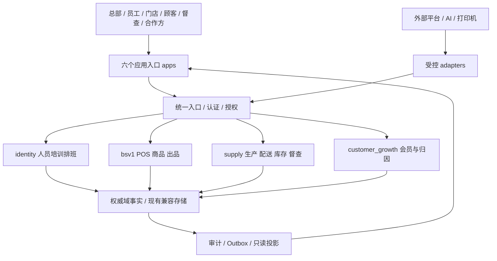

# BSV ALL 2026–2031｜五年企业软件底层架构总纲
Enterprise Architecture · System Map · Domain Ownership · Database · API · Events · Security · Deployment · AI Handoff
版本 FOUNDATION-1.0-RC1 | 2026-11-27 | PROPOSED_BASELINE / NOT_RUNTIME_CERTIFIED
本文件是人和AI的统一阅读入口；[持续功能清单](../BSV_ALL_LIVING_MODULE_REGISTER.md)负责变化，原 config 注册表负责机器事实。本文件不替换母版、注册表、真实服务或发布控制。先读本文，然后 [独立审计](AUDIT_AND_FIVE_YEAR_RISK_REGISTER.md)、[实现与接管手册](IMPLEMENTATION_API_DATABASE_RELEASE_AI_HANDOFF.md)、[机器索引](ARCHITECTURE_REFERENCE_INDEX.json)。冻结须负责人批准；现阶段不启动 #52/#59，不影响 #44/#58。

## 1. 一眼看懂：C4层级及业务边界
系统上下文：经营负责人/总部、门店员工、顾客、独立督查、合作方 -> BSV ALL；外部支付、市场平台、AI及设备 -> 受控适配器 -> BSV ALL。BSV1/2/3是企业业务责任圈层，不是软件版本、进程或数据库；现行中央供货注册在BSV2，门店基础库存属BSV1，不在本审计重分类。

容器级：参考集成分支存在四个业务后端目录；不等于四个实际独立进程。网关负责入口与路由；identity服务负责认证关联、人员、授权、学院和排班；bsv1负责订单/桌台、商品投影、出品及相关UI；supply负责供货业务入口及A–G适配；customer_growth负责顾客注册、同意与归因。具体进程、运行SHA、数据位置以受控主机证据为准，不公开真实端口/地址/私有日志。组件和代码级详见实现手册与机器索引。
### 层级约束
- L0 业务圈层 BSV1/2/3：仅经营归属。
- L1 入口：六个UI入口；不得绕过业务API访问数据库。
- L2 管理索引 M01–M25：供人/AI快速检索；不作为数据库主键或部署单元。
- L3 技术模块：config/change-routing.json的module_id；新增路由需注册，不把M号直接当module_id。
- L4 20个数据域：由config/domain-registry.json和data-ownership.json定义；多个域可在同一PG，一域可使用受控投影，事实只有一个权威写入者。
- L5 物理运行/存储：依据release manifest与实际schema；技术变化可通过兼容迁移完成。

## 2. 永久目录及责任
|根目录|唯一职责|
|---|---|
|.github|CI与审查自动化|
|apps|页面、展示、用户工作流|
|capabilities|业务圈层能力与用例|
|domains|业务语义、实体、约束|
|services|API、任务、同步等运行实现|
|integrations|外部平台/设备/AI适配器|
|cloudbase|历史官方迁移、审计及计划|
|contracts|稳定API、事件、数据、导入契约|
|platform|部署、环境、运行控制及隔离迁移|
|ingestion|导入、校验、隔离、映射|
|docs|治理、决策、架构、操作手册|
|config|注册表及非秘密逻辑配置|
|tests|自动化业务/契约/权限/回归验证|
|scripts|受控工程工具|
保留所有根目录，新增功能放在现有二三级目录；根目录或权威ID变更只允许ADR+兼容迁移。不能以五年架构为由重写现有应用或强制物理迁库。

## 3. 技术决策：冻结什么、允许什么
|决策|稳定约束|允许演进|
|---|---|---|
|F01 身份|永久自然人身份、经批准的员工派生码及别名；一人多门店授权|认证提供者、UI、权限细分|
|F02 主数据|商品/物料、门店、员工、客户各唯一owner，不能用名称/SKU作连接键|字段、分类、导入方式、物理库|
|F03 交易|订单、收款、支付机构确认、库存流水分别有权威事实|新支付渠道、新门店、POS界面|
|F04 依赖|跨域通过已批准API/事件或受控只读投影；跨域事务只能由已指定协调者完成|模块内部实现、可测试的提取|
|F05 历史|事件与历史快照不无痕覆盖；纠错追加；历史成本/价格/配方保持版本|新的报告算法及补偿规则|
|F06 租户|法人/门店范围由服务端授权；未来外部租户禁止共用无隔离主档|新增组织和租户、依法独立数据|
|F07 发布|一个已批准写入负责人、不可变发布SHA、版本证据、恢复路径|部署工具、主机、数据库版本|
|F08 演进|ADR只处理实质性架构改动；旧决策保留并标superseded；新功能先登记议案|日常兼容扩展无需总架构重审|
|F09 安全|凭证/真实经营数据不进公开Git；外部AI只通过授权接口，风险动作审批|新的供应商、设备、模型|
|F10 生存|核心营业不依赖可选AI/增长/通知；失效权限/未确认资金/不安全食品均fail closed|离线合法工作方式与受控同步|
任何不可逆变更或拆分需要回滚/前向修复计划，版本兼容和数据保全。冻结是规则不是停止改进。

## 4. 权威索引及查找入口
优先级：现行经批准治理/ADR及数据owner > 与该环境匹配的schema和API契约 > 已批准实际运行证据（说明实现现状而非授权） > 阅读索引 > 讨论。冲突登记并停止相关危险写入，不自动选任意版本。
- main 的 config/architecture-lock.json、app-registry.json、domain-registry.json、data-ownership.json、use-case-registry.json 是治理基线。
- 参考开发分支的 config/change-routing.json、data-contracts.json、contracts/database、contracts/supply、contracts/identity、contracts/menu 作为已有实现契约证据；main尚未包含前两文件，不能假定已合并。
- 实际主机与发布证据由 docs/ops/CURRENT_STATE.md 及受控证据清单维护；公开Git只放无敏感内容的哈希及状态。
- [25模块及活动议案](../BSV_ALL_LIVING_MODULE_REGISTER.md)；[机器索引](ARCHITECTURE_REFERENCE_INDEX.json)包含6入口、20域、65键及12路由引用。索引是固定SHA的审计快照，不是新权威注册表。
- PR #57 后续任务路线；#44/#58 当前发布门禁；#52中央供货唯一执行卡，#59/SUP-59候选需求。
 
## 5. 2026–2031演进路径（条件触发，非日期承诺）
2026–27：当前M1上线、实机恢复证据、正式商品与身份、供货/报损、考勤任务。保持模块化单体/既有少量服务，优先用户可用。2027–28：实测多店并发、仓储和财务对账、统一审计及服务SLO；按实际需求实现订阅/自动化。2028–29：如对外商业化，先做tenant隔离、合同/数据归属、导出删除与审计；不要将直营和外部客户混在一个无隔离空间。2029–31：仅当资源瓶颈、故障域、独立发布或组织规模的实测证据支持时拆分服务或分库；先契约兼容、迁移、双阶段验证与回退。
容量测试设计：以实际门店峰值订单/分钟、同时在线设备、物料记录与报表查询为基线，分别测试1x/3x/10x合成负载；真实容量未知，不预报可承载门店数。每次新增基础设施必须比较改造成本、运营负担与收益，不引入无需求的Kubernetes、Kafka或微服务。
 
## 6. 资料查找命名
本目录稳定搜索名：BSV ALL FIVE YEAR FOUNDATION / 五年底层架构 / 系统总图 / 数据库 / API / 模块 / 权限 / 部署 / 交接 / AI。文件名采用可检索ASCII；标题含中英文关键词。固定版本档案用不可变Git SHA与ZIP，不靠聊天名称。活文档允许随时修订，历史通过Git追溯。
 
## 7. 参考方法（不是第三方对BSV的认证）
C4：https://c4model.com/introduction
Microsoft domain analysis：https://learn.microsoft.com/en-us/azure/architecture/microservices/model/domain-analysis
AWS ADR：https://docs.aws.amazon.com/prescriptive-guidance/latest/architectural-decision-records/
AWS transactional outbox：https://docs.aws.amazon.com/prescriptive-guidance/latest/cloud-design-patterns/transactional-outbox.html
OWASP object authorization：https://owasp.org/projects/api-security-project
