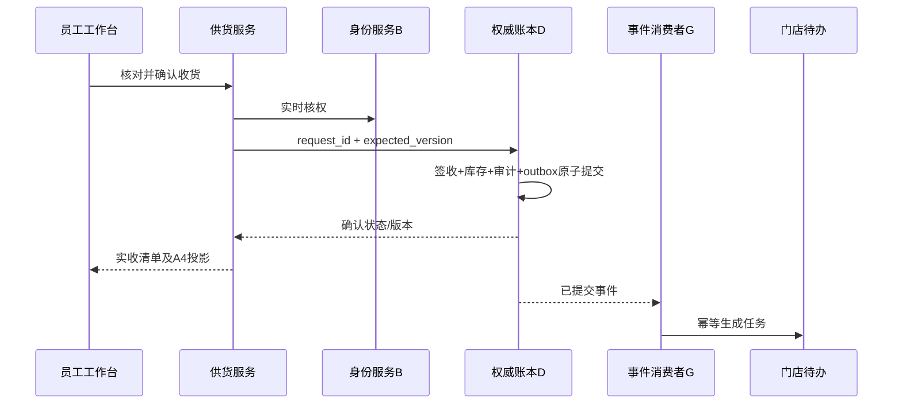

# BSV ALL｜工程实施手册：代码、API、数据库、事务、发布与AI交接
FOUNDATION-1.0-RC1；以下代码片段为规范示例，非已部署代码。实际路径与schema以固定参考树及运行证据为准。
## 1. 代码定位（参考2052ef51f011be3c5898d816932d8982f420b752）
|业务|现有代码入口|先读契约|执行测试|
|---|---|---|---|
|人员/权限|services/api/identity/api.py；apps/hq-console/identity；apps/staff-center/identity|contracts/identity/identity.openapi.json；config/modules/identity-data-sources.json|tests/identity|
|学院/排班|services/api/identity/academy_api.py、academy_policy.py；apps/staff-center/identity|contracts/academy/V4_1.md|tests/v4-1|
|商品/配方|services/api/bsv1/bsv_catalog_repository.py、bsv_catalog_contract.py、bsv_catalog_import.py|config/data-contracts.json；contracts/bsv1/data-routes.json|tests/bsv1、tests/contracts|
|POS/桌台/调酒|services/api/bsv1/app.py、bsv_layouts.py、bsv_device_pos.py；apps/store-console/bsv1|contracts/database/BASELINE.md；config/change-routing.json|tests/bsv1、tests/internal-stage|
|供货/库存/督查|services/api/supply/main.py、domain.py、gateway.py、shipment_contract.py；apps/hq-console/supply|contracts/supply/HANDOFF.md、openapi.json|tests/supply|
|会员/归因|services/api/customer_growth/app.py、services/api/bsv1/bsv_growth_pos.py|contracts/customer-growth/pos-visit-context.schema.json|tests/customer_growth|
|对客菜单|apps/guest-web/bsv1；services/api/bsv1/public_menu_projection.py|contracts/menu/public-menu-v2.schema.json|tests/internal-stage|
|外部视觉/标签|integrations/vision/supply_photo.py；integrations/devices|contracts/supply/HANDOFF.md|tests/supply；打印实际设备另验|
|部署控制|platform/lighthouse/internal-stage/bsvctl.py、stage.py、ingress.py|docs/architecture/BSV_ALL_DELIVERY_CONTROL_PLANE_V1.md|tests/internal-stage、tests/ui|
其余业务以持续功能清单定位；设计功能不要捏造实际文件。目录分层建议：页面调用API→认证/动作授权→业务命令处理→owner仓储事务→审计/事件→投影；禁止页面直接写表。
## 2. 统一数据使用
每个业务实体由config/data-ownership.json唯一指定owner，索引只引用，不重新声明所有权。环境登记每个域的 logical_source_id / authority_writer / schema_revision / deployed_sha / config_digest / evidence_ref / verified_at / state。物理连接和凭据只在私有运行配置中。参考契约业务PG17、身份隔离PG、POS SQLite、增长存储、供货demo/cache并存；禁止未经ADR物理合库或自动failover写入。
供货A商品只读；B身份实时核权；C门店库位只读；D生产/库存/采购事务；E独立督查；F识别候选；G通知。identity.A不同于supply.A。正式D和E接通状态未知。实体保持永久ID，历史别名按法人+来源系统+原值映射；日期UTC存储、北京时区显示；金额整数分+币种；数量Decimal+单位；原料质量与储运规则按批准版本保存。
## 3. 命令与事件标准
已有API路径保持兼容；新版本优先/api/v1，旧路径保留适配器而非同步双写。下例为候选扩展请求结构，不是实际端点。
```json
{
  "request_id": "synthetic-uuid",
  "expected_version": 3,
  "shipment_id": "synthetic-shipment",
  "packages": [
    {"package_id": "synthetic-package", "accepted_quantity": "350", "unit": "mL"}
  ]
}
```
actor、legal_entity、store、时间由认证及服务端事实解析，不接受任意客户端伪造。业务错误稳定映射（候选）：401未认证、403无操作权限、409版本/幂等冲突、422业务规则不符、503权威服务不可用；现有接口错误码优先，变化需兼容。相同幂等key+相同规范请求返回原结果；同key不同内容拒绝。
```python
# 伪代码；使用现有D事务和outbox，不直接执行
def receive_shipment(session, request):
    actor = authorize(session, action="receive", object_id=request.shipment_id)
    with owner_transaction() as tx:
        prior = tx.claim_idempotency(actor.scope, request.request_id, canonical_hash(request))
        if prior.completed:
            return prior.result
        shipment = tx.lock_shipment(request.shipment_id)
        validate_scope_version_and_packages(actor, shipment, request)
        # 入库只限有效合格件；差异留在途或隔离
        result = apply_receipt_and_inventory_movements(tx, shipment, request)
        tx.append_audit(actor, result)
        tx.append_outbox(event_from(result))
        tx.finish_idempotency(prior, result)
    return result
```
事件采用 contracts/API_AND_EVENTS.md 元字段；新增事件必须有生产者、消费者、schema_version、实体版本、幂等策略、重试/死信/补偿、保留策略。例：shipment.received.v1 由D已提交后产生；service_ops生成任务；通知失败不撤销库存。消费者使用event_id唯一约束，在同一消费事务更新投影及处理记录；允许至少一次投递，不宣称网络端到端exactly once。未知事件版本进入隔离，不静默丢弃。 

## 4. 数据库变更与恢复（扩展—迁移—收缩）
1. 读真实schema、主外键、权限、迁移账本、当前写源；建立前后不变量及数据样本检查。2. 经审核新增向后兼容字段/表/索引；只在隔离执行；不直接执行历史候选SQL。3. 批次回填，验证计数、金额、数量与历史ID；高风险切换前备份及隔离恢复。4. 双版本读兼容但只有一个权威写源；切换后实机验证并观察。5. 待旧版本退役再另批清理，保留法规及审计要求。代码回滚不等于数据库回滚；出现新交易优先前向修复或重放可验证事件，不能覆盖新事实。
迁移账本沿用现有环境授权工具；cloudbase/migrations是原治理规定的正式迁移目录，platform/lighthouse下已有隔离PG/身份迁移不能冒称统一生产迁移；物理迁库需要ADR。
## 5. 业务联动模板（候选）
生产→配送→库存→任务：catalog批准效期及SOP→production batch→package/label→shipment→签收原子写D→库存余额/死期→service_ops工作台。考勤事件由workforce产生，任务完成不改考勤。A4到货表及死期表从已提交数据生成，死期表含历史未耗完批次，注明生成时刻/版本；到期隔离与实际销毁分离。 
订单→出品→库存→支付→财务：订单只属于commerce；批准配方按版本引用；出品与耗用独立去重；真实付款由payments可信确认；财务读真实账本，人工登记不等于支付机构到账。
会员→消费归因→佣金：customer管理会员/同意，marketing管理归因，实际付款与可核验消费触发佣金候选，operating_finance结算。不得双重认领/重复结算。
## 6. 新需求到交付的固定流程
- READ：本五年总纲、持续功能清单、已有关联Issue、技术注册表、实际候选SHA、现有代码与接口。先查已有实现。
- MAP：在功能清单登记议案ID、模块M号、真正技术module_id、PRIMARY/ADAPTER/READ/EVENT/NO_CHANGE、数据owner、输入输出、状态、现有执行卡；无法映射则候选注册，不能擅自造模块。
- DESIGN：写明最小增量、非目标、依赖、兼容与回退、正反验收；影响冻结规则才开ADR；常规UI/字段兼容改动按现有路由卡。
- APPROVE：负责人批准议案与开工是两件事，生产另批。#44/#58当前优先；不得自动启动SUP-59。
- IMPLEMENT：独立worktree/分支/唯一文件owner，禁止并发共享写入；短小提交。按定向CI、契约、隔离浏览器、业务数据对账、回退验证完成。
- RELEASE：发布manifest包括base/head/approved/deployed SHA、CI、schema/config版本、构件摘要、证据、回退与授权；实机检查真实入口及重启持久化。失败保留事实并标BLOCKED；不自动进入下一任务。
- CLOSE：只更新实际验证过的状态，保留证据，停写，交接。否决方案移除活动括号，历史保留。
 
### AI交接机器样例（候选，非运行命令）
```json
{
  "proposal_id":"SUP-59",
  "execution_issue":52,
  "status":"PROPOSED",
  "modules":["supply-api","device-label","store-shifts"],
  "read":["supply.A","supply.B","supply.C"],
  "write_via":["supply.D"],
  "events":["shipment.received.v1"],
  "non_goals":["new_product_master","new_identity_master","payment_changes"],
  "environment":"isolated",
  "approval":"not_started",
  "acceptance":["10 dispatch 9 receive","repeat idempotent","wrong store denied","expired unavailable"],
  "rollback":"feature_disable_preserve_committed_stock"
}
```
实际M索引映射更多模块，完整见持续清单；没有现有module_id的任务/通知先登记候选接口，不造ID。 
## 7. 检查与规模门槛
现有 scripts/verify_architecture.py（治理）、scripts/verify_change_routing.py（参考开发分支）、tests/contracts 与各模块测试为优先复用入口。新增静态门禁脚本仅检查根目录、注册owner、应用路径、路由路径及别名一致性，不能替代CI、运行核验及人审。
建议SLO须负责人批准且实测：核心营业操作P95延迟、成功率、错误、峰值负载；库存/财务可核验一致性为100%；不允许跨店越权、重复记账、过期出品；RPO/RTO依据可接受经营损失设定并实测恢复。容量、费用、故障时间未测，禁止宣布可支持某个门店规模。新增服务前对1x/3x/10x实际峰值合成压测；有可观测瓶颈才做拆分。
## 8. 新接管人员10分钟阅读顺序
五年总纲→持续清单→本手册→对应原契约→真实发布证据→单个Issue。不需重读所有历史聊天；遇事实冲突回到权威源，明确未知/阻断。所有代码示例仅用于说明，不可复制到生产执行。
